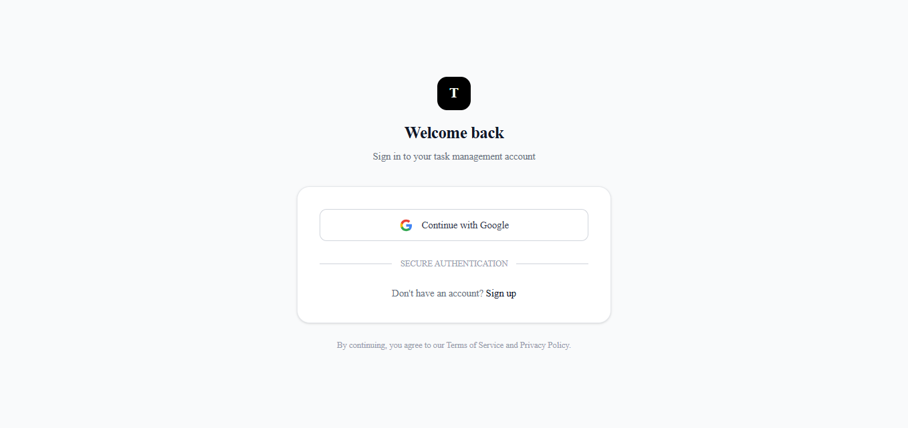
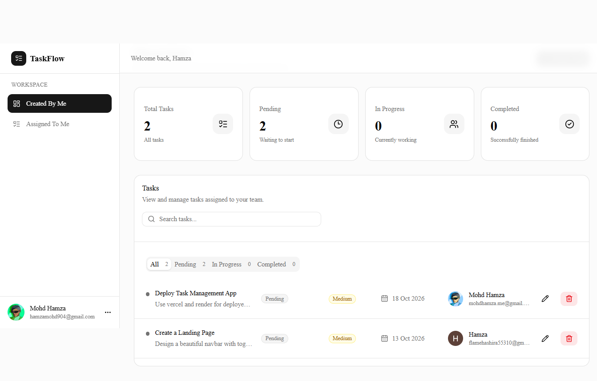
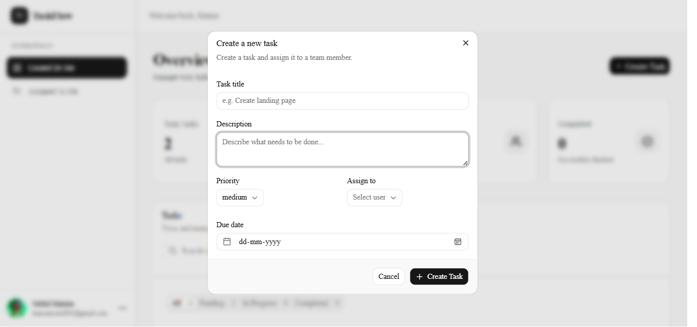
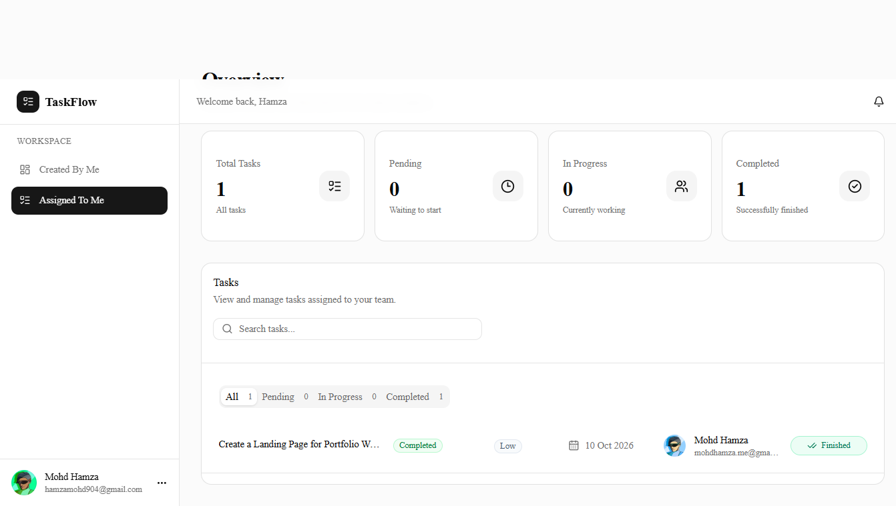

# Task Management App

### 1. Overview

Task Management App is a full-stack web application that allows authenticated users to create and manage tasks, assign tasks to other users, and receive email notifications when tasks are created or completed.

### 2. Features

- Google OAuth 2.0 authentication
- User login/logout
- Create tasks with a title, description, priority, and due date
- Assign tasks to other registered users
- View assigned/created tasks
- Track task progress (pending, in progress, completed)
- Mark tasks as completed
- Gmail email notification when a task is created
- Gmail email notification when a task is completed
- Protected routes
- Responsive UI

### 3. Tech Stack

| Layer           | Technology                       |
| --------------- | -------------------------------- |
| Frontend        | Next.js, TypeScript              |
| Backend         | Flask, Python                    |
| Database        | Supabase PostgreSQL              |
| Authentication  | Google OAuth 2.0 + Supabase Auth |
| Email           | Gmail                            |
| Deployment      | Vercel + Render                  |
| Version Control | Git + GitHub                     |

### 4. Architecture

```
                    ┌─────────────────────┐
                    │       User          │
                    └──────────┬──────────┘
                               │
                               ▼
                    ┌─────────────────────┐
                    │ Next.js Frontend    │
                    │ TypeScript          │
                    └──────────┬──────────┘
                               │ REST API
                               ▼
                    ┌─────────────────────┐
                    │ Flask Backend       │
                    │                     │
                    │ Authentication      │
                    │ Task APIs           │
                    │ Email notifications │
                    └───────┬───────┬─────┘
                            │       │
                 ┌──────────┘       └──────────┐
                 ▼                             ▼
       ┌──────────────────┐          ┌──────────────────┐
       │ Supabase         │          │ Gmail            │
       │ PostgreSQL       │          │ Email Service    │
       └──────────────────┘          └──────────────────┘
```

The application follows a three-layer architecture consisting of a Next.js frontend, Flask backend, and Supabase PostgreSQL database.

The frontend is responsible for the user interface, authentication flow, task management screens, and communicating with the Flask REST API.

The Flask backend handles business logic, validates requests, interacts with Supabase, and triggers email notifications through Gmail.

Supabase PostgreSQL stores profiles and task-related data. Google OAuth 2.0 is used for authentication, while Gmail is used to send task-related email notifications.

### 5. Project Structure

```
task-management-app/

frontend
|-- public
|   |-- file.svg
|   |-- globe.svg
|   |-- next.svg
|   |-- vercel.svg
|   \-- window.svg
|-- src
|   |-- app
|   |   |-- (auth)
|   |   |   |-- login
|   |   |   |   \-- page.tsx
|   |   |   \-- signup
|   |   |       \-- page.tsx
|   |   |-- (protected)
|   |   |   |-- dashboard
|   |   |   |   |-- assigned
|   |   |   |   |   \-- page.tsx
|   |   |   |   |-- created
|   |   |   |   |   \-- page.tsx
|   |   |   |   \-- page.tsx
|   |   |   |-- tasks
|   |   |   |   \-- [id]
|   |   |   |       \-- page.tsx
|   |   |   \-- layout.tsx
|   |   |-- auth
|   |   |   \-- callback
|   |   |       \-- route.ts
|   |   |-- favicon.ico
|   |   |-- globals.css
|   |   |-- layout.tsx
|   |   |-- not-found.tsx
|   |   |-- page.tsx
|   |   \-- Providers.tsx
|   |-- components
|   |   |-- ui
|   |   |   |-- avatar.tsx
|   |   |   |-- badge.tsx
|   |   |   |-- button.tsx
|   |   |   |-- card.tsx
|   |   |   |-- dialog.tsx
|   |   |   |-- dropdown-menu.tsx
|   |   |   |-- input.tsx
|   |   |   |-- label.tsx
|   |   |   |-- select.tsx
|   |   |   |-- separator.tsx
|   |   |   |-- skeleton.tsx
|   |   |   |-- spinner.tsx
|   |   |   |-- tabs.tsx
|   |   |   |-- textarea.tsx
|   |   |   \-- toast.tsx
|   |   |-- AssignedTaskRow.tsx
|   |   |-- AssignedTasks.tsx
|   |   |-- AssignedTaskStats.tsx
|   |   |-- AuthCard.tsx
|   |   |-- CreatedTasks.tsx
|   |   |-- CreatedTaskStats.tsx
|   |   |-- CreateTaskDialog.tsx
|   |   |-- EditTaskDialog.tsx
|   |   |-- SidebarItem.tsx
|   |   |-- SidebarUserMenu.tsx
|   |   \-- StatsError.tsx
|   |-- hooks
|   |   \-- useIntersectionObserver.ts
|   |-- lib
|   |   |-- api
|   |   |   |-- client.ts
|   |   |   |-- tasks.ts
|   |   |   \-- users.ts
|   |   |-- supabase
|   |   |   |-- client.ts
|   |   |   \-- server.ts
|   |   \-- utils.ts
|   \-- schema
|       \-- task.schema.ts
|-- .env
|-- .env.example
|-- .env.local
|-- .gitignore
|-- components.json
|-- eslint.config.mjs
|-- next.config.ts
|-- next-env.d.ts
|-- package.json
|-- package-lock.json
|-- postcss.config.mjs
|-- README.md
\-- tsconfig.json


FLASK PROJECT STRUCTURE
|-- app
|   |-- auth
|   |   `-- decorators.py
|   |-- routes
|   |   |-- task.py
|   |   `-- users.py
|   |-- schemas
|   |   `-- task.py
|   |-- services
|   |   `-- email_service.py
|   |-- config.py
|   |-- extensions.py
|   `-- supabase.py
|-- .env
|-- .env.example
|-- .gitignore
|-- requirements.txt
`-- run.py
```

### 6. Authentication Flow

```
User
 ↓
Login with Google
 ↓
Google OAuth
 ↓
Supabase Auth
 ↓
Authenticated User
 ↓
Dashboard
```

1. The user clicks **Continue with Google** on the login page.
2. Supabase Auth redirects the user to Google's consent screen.
3. After consent, Google redirects back to Supabase, which then redirects to the frontend callback route (`/auth/callback`).
4. The callback route exchanges the authorization code for a Supabase session and stores it in secure cookies.
5. On first sign-in, a database trigger automatically creates a row in `public.profiles` using the user's Google name, email, and avatar.
6. Routes under `(protected)` check for a valid session and redirect unauthenticated users to `/login`.
7. For every API call, the frontend sends the Supabase access token in the `Authorization: Bearer <token>` header. The Flask `auth/decorators.py` decorator validates the token with Supabase before the request reaches a route.

### 7. Task Flow

```
Create task (title, description, priority, due date, assignee)
 ↓
Flask validates the request and saves the task (status: pending)
 ↓
Email sent to the assignee (if the task is assigned)
 ↓
Task appears under "Assigned to me" for the assignee
and under "Created by me" for the creator
 ↓
Assignee starts working (status: in_progress)
 ↓
Assignee marks the task as completed
 ↓
Flask sets status = completed and completed_at = now()
 ↓
Email sent to the task creator
```

- **Created tasks**: tasks the logged-in user created, regardless of who they were assigned to.
- **Assigned tasks**: tasks assigned to the logged-in user by someone else.
- **Status**: `pending` → `in_progress` → `completed`.
- **Priority**: `low`, `medium` (default), or `high`.
- A task can exist without an assignee. If the assigned user's profile is deleted, `assigned_to` is set to `NULL` and the task is kept.
- Only the creator or assignee can update a task; this is enforced on the backend, not just in the UI.

### 8. Email Notification Flow

```
Task created / completed
 ↓
Flask route calls email_service.py
 ↓
Email built (subject + HTML body)
 ↓
Sent through Gmail SMTP
 ↓
Recipient receives the notification
```

| Event          | Recipient    | Content                                              |
| -------------- | ------------ | ---------------------------------------------------- |
| Task created   | Assignee     | Task title, description, priority, creator, due date |
| Task completed | Task creator | Task title, who completed it, completion time        |

Emails are sent through Gmail's SMTP server, configured with the `MAIL_USERNAME`, `MAIL_PASSWORD` and `MAIL_SERVER` environment variables. `MAIL_PASSWORD` must be a Gmail **App Password** (not the account's normal password). Email failures are logged and do not block the task from being saved.

### 9. Database Schema

#### Enums

| Enum            | Values                                |
| --------------- | ------------------------------------- |
| `role_enum`     | `user`, `admin`                       |
| `task_status`   | `pending`, `in_progress`, `completed` |
| `task_priority` | `low`, `medium`, `high`               |

#### `profiles`

Created automatically for every new user who signs in with Google (via a trigger on `auth.users`).

| Column       | Type        | Notes                                          |
| ------------ | ----------- | ---------------------------------------------- |
| `id`         | uuid (PK)   | References `auth.users(id)`, cascade on delete |
| `email`      | text        | Required                                       |
| `full_name`  | text        | Nullable, taken from Google profile            |
| `avatar_url` | text        | Nullable, taken from Google profile            |
| `role`       | role_enum   | Default `user`                                 |
| `created_at` | timestamptz | Default `now()`                                |

#### `tasks`

| Column         | Type          | Notes                                              |
| -------------- | ------------- | -------------------------------------------------- |
| `id`           | uuid (PK)     | Default `gen_random_uuid()`                        |
| `title`        | text          | Required                                           |
| `description`  | text          | Nullable                                           |
| `status`       | task_status   | Default `pending`                                  |
| `priority`     | task_priority | Default `medium`                                   |
| `due_date`     | timestamptz   | Nullable                                           |
| `created_by`   | uuid (FK)     | References `profiles(id)`, cascade on delete       |
| `assigned_to`  | uuid (FK)     | References `profiles(id)`, set to null on delete   |
| `created_at`   | timestamptz   | Default `now()`                                    |
| `updated_at`   | timestamptz   | Auto-updated by the `trg_tasks_updated_at` trigger |
| `completed_at` | timestamptz   | Nullable, set when the task is completed           |

#### Relationships

```
profiles 1 ────< tasks (created_by)
profiles 1 ────< tasks (assigned_to)
```

#### Indexes

- `idx_tasks_assigned_to` on `tasks(assigned_to)`
- `idx_tasks_created_by` on `tasks(created_by)`
- `idx_tasks_status` on `tasks(status)`

### 10. Environment Variables

#### Frontend (`frontend/.env`)

```env
NEXT_PUBLIC_SUPABASE_URL=your_supabase_project_url
NEXT_PUBLIC_SUPABASE_PUBLISHABLE_KEY=your_supabase_publishable_key
GOOGLE_CLIENT_ID=your_google_oauth_client_id
GOOGLE_CLIENT_SECRET=your_google_oauth_client_secret
NEXT_PUBLIC_FLASK_API_URL=http://localhost:5000
```

| Variable                               | Description                                        |
| -------------------------------------- | -------------------------------------------------- |
| `NEXT_PUBLIC_SUPABASE_URL`             | Your Supabase project URL                          |
| `NEXT_PUBLIC_SUPABASE_PUBLISHABLE_KEY` | Supabase publishable (public) key                  |
| `GOOGLE_CLIENT_ID`                     | Client ID of your Google OAuth 2.0 credentials     |
| `GOOGLE_CLIENT_SECRET`                 | Client secret of your Google OAuth 2.0 credentials |
| `NEXT_PUBLIC_FLASK_API_URL`            | Base URL of the Flask backend                      |

#### Backend (`backend/.env`)

```env
SUPABASE_URL=your_supabase_project_url
SUPABASE_SERVICE_ROLE_KEY=your_supabase_service_role_key
MAIL_USERNAME=your_gmail_address
MAIL_PASSWORD=your_gmail_app_password
MAIL_SERVER=smtp.gmail.com
```

| Variable                    | Description                                             |
| --------------------------- | ------------------------------------------------------- |
| `SUPABASE_URL`              | Your Supabase project URL                               |
| `SUPABASE_SERVICE_ROLE_KEY` | Supabase service role key (backend only, bypasses RLS)  |
| `MAIL_USERNAME`             | Gmail address used to send notifications                |
| `MAIL_PASSWORD`             | Gmail **App Password** (not your normal Gmail password) |
| `MAIL_SERVER`               | SMTP server, `smtp.gmail.com` for Gmail                 |

> Never commit real keys. Only the `.env.example` files should be in version control. The service role key and `GOOGLE_CLIENT_SECRET` must never be exposed to the browser, which is why they don't use the `NEXT_PUBLIC_` prefix.

### 11. Local Setup

#### Prerequisites

- Node.js 18+ and npm
- Python 3.12+
- A Supabase project
- A Google Cloud project with an OAuth 2.0 client
- A Gmail account with 2-Step Verification and an App Password

#### 1. Clone the repository

```bash
git clone https://github.com/Mohd-Hamza-123/Task-Management-Application.git
cd Task-Management-Application
```

#### 2. Set up the database

Run the migration files in order, as described in [Database Migrations](#12-database-migrations).

#### 3. Configure Google OAuth and Supabase

1. In Google Cloud Console, create an OAuth 2.0 Client ID (Web application).
2. Add the Supabase callback URL (`https://<project-ref>.supabase.co/auth/v1/callback`) as an authorized redirect URI.
3. In Supabase, go to **Authentication → Providers → Google**, enable it, and paste the same Client ID and Secret you put in `frontend/.env`.
4. In **Authentication → URL Configuration**, set the Site URL to `http://localhost:3000` and add `http://localhost:3000/auth/callback` to the redirect URLs.

#### 4. Run the backend

```bash
cd backend
python -m venv venv
source venv/bin/activate        # Windows: venv\Scripts\activate
pip install -r requirements.txt
cp .env.example .env            # then fill in the values
python run.py
```

The API runs at `http://localhost:5000`.

#### 5. Run the frontend

```bash
cd frontend
npm install
cp .env.example .env      # then fill in the values
npm run dev
```

The app runs at `http://localhost:3000`.

### 12. Database Migrations

Migration files are in the `migrations/` folder and must be run in order:

| File                            | Description                                                                                                   |
| ------------------------------- | ------------------------------------------------------------------------------------------------------------- |
| `001_create_profiles_table.sql` | Creates `role_enum`, the `profiles` table, and a trigger that creates a profile on sign-up                    |
| `002_create_tasks_table.sql`    | Creates the `task_status` and `task_priority` enums, the `tasks` table, the `updated_at` trigger, and indexes |

#### Option 1: Supabase SQL Editor

1. Open your project in the Supabase dashboard.
2. Go to **SQL Editor → New query**.
3. Paste the contents of `001_create_profiles_table.sql` and click **Run**.
4. Repeat for `002_create_tasks_table.sql`.

#### Option 2: Supabase CLI

```bash
supabase link --project-ref <your-project-ref>
supabase db push
```

> For the CLI, the files need to be in `supabase/migrations/` with timestamp-style names (for example `20260101000000_create_profiles_table.sql`).

### 13. API Endpoints

All endpoints require the header `Authorization: Bearer <supabase_access_token>`.

#### Tasks

| Method | Endpoint                   | Description                                             |
| ------ | -------------------------- | ------------------------------------------------------- |
| POST   | `/api/tasks`               | Create a task and email the assignee                    |
| GET    | `/api/tasks`               | Tasks created by the current user (paginated)           |
| GET    | `/api/assigned-tasks`      | Tasks assigned to the current user (paginated)          |
| GET    | `/api/task/<id>`           | Get a single task                                       |
| PATCH  | `/api/tasks/<id>`          | Update a task; emails the creator when marked completed |
| DELETE | `/api/tasks/<id>`          | Delete a task                                           |
| GET    | `/api/task-stats`          | Task counts for tasks created by the current user       |
| GET    | `/api/assigned-task-stats` | Task counts for tasks assigned to the current user      |

#### Users

| Method | Endpoint     | Description                                                                   |
| ------ | ------------ | ----------------------------------------------------------------------------- |
| GET    | `/api/users` | List all registered users except the current user (for the assignee dropdown) |

Response `200 OK` (a plain array, not wrapped in `data`):

```json
[
  {
    "id": "b1c2d3e4-0000-0000-0000-000000000000",
    "full_name": "Jane Doe",
    "email": "jane@example.com"
  }
]
```

#### Pagination

`GET /api/tasks` and `GET /api/assigned-tasks` accept these query parameters:

| Parameter | Type | Default | Description    |
| --------- | ---- | ------- | -------------- |
| `page`    | int  | `1`     | Page number    |
| `limit`   | int  | `5`     | Items per page |

Response `200 OK`:

```json
{
  "data": [
    {
      "id": "f5a1c2b3-0000-0000-0000-000000000000",
      "title": "Prepare weekly report",
      "description": "Summarize sprint progress",
      "status": "pending",
      "priority": "high",
      "due_date": "2026-10-20T17:00:00Z",
      "assigned_to": "b1c2d3e4-0000-0000-0000-000000000000",
      "assigned_user": {
        "id": "b1c2d3e4-0000-0000-0000-000000000000",
        "full_name": "Jane Doe",
        "email": "jane@example.com",
        "avatar_url": "https://..."
      }
    }
  ],
  "page": 1,
  "limit": 5,
  "hasNextPage": false,
  "nextPage": null
}
```

For `/api/assigned-tasks`, each task contains a `created_by` object (`id`, `full_name`, `email`, `avatar_url`) instead of `assigned_user`.

#### Create a task

```http
POST /api/tasks
Content-Type: application/json
Authorization: Bearer <token>

{
  "title": "Prepare weekly report",
  "description": "Summarize sprint progress",
  "priority": "high",
  "assigned_to": "b1c2d3e4-0000-0000-0000-000000000000",
  "due_date": "2026-10-20T17:00:00Z"
}
```

| Field         | Type   | Values / format              |
| ------------- | ------ | ---------------------------- |
| `title`       | string | Required                     |
| `description` | string | Optional                     |
| `priority`    | string | `low`, `medium`, `high`      |
| `assigned_to` | string | UUID of a registered user    |
| `due_date`    | string | Optional, ISO 8601 timestamp |

The request body is validated with Pydantic. Response `201 Created`:

```json
{
  "data": [
    {
      "id": "f5a1c2b3-0000-0000-0000-000000000000",
      "title": "Prepare weekly report",
      "description": "Summarize sprint progress",
      "status": "pending",
      "priority": "high",
      "due_date": "2026-10-20T17:00:00Z",
      "assigned_to": "b1c2d3e4-0000-0000-0000-000000000000",
      "assigned_user": {
        "id": "...",
        "full_name": "Jane Doe",
        "email": "jane@example.com",
        "avatar_url": "..."
      }
    }
  ]
}
```

#### Update a task

```http
PATCH /api/tasks/<id>
Content-Type: application/json
Authorization: Bearer <token>

{
  "status": "completed",
  "completed_at": "2026-10-12T10:30:00Z"
}
```

Allowed fields: `title`, `description`, `due_date`, `assigned_to`, `priority`, `status`, `completed_at`. Any other field is ignored.

Permission rules:

| Action                          | Who can do it            |
| ------------------------------- | ------------------------ |
| Update a task                   | Task creator or assignee |
| Reassign a task (`assigned_to`) | Task creator only        |
| Change `status`                 | Task assignee only       |

Valid statuses are `pending`, `in_progress` and `completed`. When a task is updated with `status: "completed"`, an email is sent to the task creator. The response returns the updated task in `data`.

#### Task stats

`GET /api/task-stats` (tasks you created) and `GET /api/assigned-task-stats` (tasks assigned to you) return the same shape:

```json
{
  "total": 12,
  "pending": 5,
  "inProgress": 4,
  "completed": 3
}
```

#### Error responses

| Status | Meaning                                                                          |
| ------ | -------------------------------------------------------------------------------- |
| 400    | Invalid request body, no valid fields to update, or invalid status               |
| 401    | Missing or invalid token                                                         |
| 403    | Not allowed (not the creator/assignee, or not allowed to reassign/change status) |
| 404    | Task not found, or `assigned_to` is not a registered user                        |
| 500    | Update failed / server error                                                     |

Validation errors from task creation return `400` with `{ "errors": [...] }`. Other errors return `{ "error": "message" }`.

### 14. Deployment

#### Backend (Render)

1. Push the repository to GitHub.
2. In Render, create a new **Web Service** and connect the repository.
3. Set the **Root Directory** to `backend`.
4. Build command: `pip install -r requirements.txt`
5. Start command: `gunicorn run:app` (add `gunicorn` to `requirements.txt`)
6. Add all backend environment variables from section 10.

#### Frontend (Vercel)

1. Import the repository in Vercel.
2. Set the **Root Directory** to `frontend`.
3. Add the frontend environment variables from section 10, setting `NEXT_PUBLIC_FLASK_API_URL` to your Render URL.
4. Deploy.

#### Post-deployment checklist

- Add the production URL to the Supabase **Site URL** and **Redirect URLs** (`https://<your-app>.vercel.app/auth/callback`).
- Make sure CORS in Flask allows the production frontend origin.
- Note that Render's free tier spins down after inactivity, so the first request may be slow.

### 15. Live Demo

- **Frontend:** https://veltoza.vercel.app
- **Backend API:** https://task-management-application-3xmw.onrender.com

### 16. Screenshots

| Login                             | Dashboard                                 |
| --------------------------------- | ----------------------------------------- |
|  |  |

| Create Task                                   | Assigned Tasks                                      |
| --------------------------------------------- | --------------------------------------------------- |
|  |  |


### 17. Future Improvements

- Due-date reminders via scheduled emails
- Task comments and activity history
- Labels and categories
- Search, filtering, and sorting
- Admin dashboard using the existing `role` column
- Row Level Security policies on `profiles` and `tasks`
- Real-time updates with Supabase Realtime
- In-app notifications
- Unit and integration tests with CI via GitHub Actions
- Dark mode
